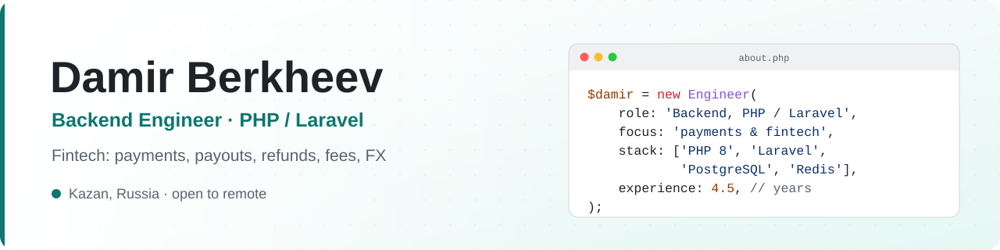
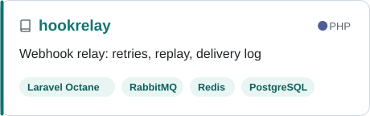
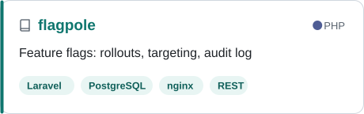
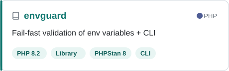
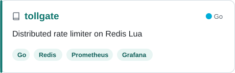
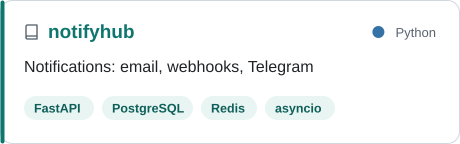

<picture>
  <source media="(prefers-color-scheme: dark)" srcset="assets/banner-dark.svg">
  
</picture>

  
  
  

<b>English</b> · <a href="#по-русски">По-русски</a>

### About me

Backend developer with **4.5 years of PHP**. For the last two years I've worked in **fintech**: a crypto payment gateway, a virtual card service and an internal CRM, built as about ten Laravel services sharing one PostgreSQL database.

- 💳 Most of my work is about money: **payments, payouts, refunds, fees and currency conversion**.
- 🧩 I've built a public merchant API, a merchant dashboard, a payment form, admin panels and an internal CRM, including a data migration from AmoCRM.
- ☎️ Before fintech: a Yii2 CRM with telephony (Asterisk), a WebSocket chat and a mobile API, and services for paying traffic fines.
- ✅ Kanban, git-flow, code review, static analysis in CI. I care about tests, clear data models and code that the next person can read.

### Tech stack

  <picture>
    <source media="(prefers-color-scheme: dark)" srcset="assets/stack-dark.svg">
    
  </picture>

<table>
  <tr><td><b>Languages & frameworks</b></td><td>PHP 8, Laravel, Laravel Octane, Laravel Nova, Yii2 · also Go, Python, JavaScript</td></tr>
  <tr><td><b>Databases</b></td><td>PostgreSQL, MySQL, Redis, query optimization</td></tr>
  <tr><td><b>Architecture & APIs</b></td><td>REST, OpenAPI/Swagger, microservices, RabbitMQ, WebSocket, OAuth, 2FA</td></tr>
  <tr><td><b>Quality</b></td><td>PHPUnit, PHPStan, Psalm, code review</td></tr>
  <tr><td><b>Infrastructure</b></td><td>Docker, docker-compose, nginx, GitLab CI, GitHub Actions, Linux, Sentry</td></tr>
</table>

### Featured projects

<table>
  <tr>
    <td>
      <a href="https://github.com/berkheev/hookrelay"><picture>
        <source media="(prefers-color-scheme: dark)" srcset="assets/cards/hookrelay-dark.svg">
        
      </picture></a>
    </td>
    <td>
      <a href="https://github.com/berkheev/flagpole"><picture>
        <source media="(prefers-color-scheme: dark)" srcset="assets/cards/flagpole-dark.svg">
        
      </picture></a>
    </td>
  </tr>
  <tr>
    <td>
      <a href="https://github.com/berkheev/envguard"><picture>
        <source media="(prefers-color-scheme: dark)" srcset="assets/cards/envguard-dark.svg">
        
      </picture></a>
    </td>
    <td>
      <a href="https://github.com/berkheev/tollgate"><picture>
        <source media="(prefers-color-scheme: dark)" srcset="assets/cards/tollgate-dark.svg">
        
      </picture></a>
    </td>
  </tr>
  <tr>
    <td colspan="2" align="center">
      <a href="https://github.com/berkheev/notifyhub"><picture>
        <source media="(prefers-color-scheme: dark)" srcset="assets/cards/notifyhub-dark.svg">
        
      </picture></a>
    </td>
  </tr>
</table>

### Experience

<table>
  <tr><td><b>Innovative Systems</b> 2024 – 2026</td><td>Backend Developer (PHP). Crypto payment gateway, virtual cards, internal CRM. Laravel, PostgreSQL, Redis</td></tr>
  <tr><td><b>Simple Payments</b> 2023 – 2024</td><td>Backend Developer. Fine payment services, email and Telegram integrations. Laravel, Yii, Sentry</td></tr>
  <tr><td><b>VA Group</b> 2022 – 2024</td><td>PHP Developer. Yii2 CRM with telephony, WebSocket chat, mobile API. MySQL, Asterisk, AWS</td></tr>
</table>

🎓 MSc in Mathematics and Computer Science, Kazan Federal University · 🌐 Russian (native), English (B2)

---

<b>По-русски</b> (нажмите, чтобы развернуть)

 

### Обо мне

Backend-разработчик, пишу на **PHP 4,5 года**. Последние два года работал в **финтехе**: крипто-платёжный шлюз, сервис виртуальных карт и внутренняя CRM. Это около десяти сервисов на Laravel с общей базой PostgreSQL.

- 💳 Большая часть задач про деньги: **платежи, выплаты, возвраты, комиссии, конвертация валют**.
- 🧩 Делал публичный API для мерчантов, личный кабинет, платёжную форму, админки и внутреннюю CRM, включая перенос данных из AmoCRM.
- ☎️ До финтеха: CRM на Yii2 с телефонией (Asterisk), чатом на WebSocket и API для мобильного приложения, сервисы оплаты штрафов.
- ✅ Канбан, git-flow, код-ревью, статический анализ в CI. Люблю тесты, понятные модели данных и код, который легко читать следующему разработчику.

### Опыт

- **ООО «Инновационные системы»**, 2024–2026: backend-разработчик (PHP). Платёжный шлюз, виртуальные карты, внутренняя CRM.
- **ООО «Простые платежи»**, 2023–2024: backend-разработчик. Сервисы оплаты штрафов, рассылки, интеграция с Telegram.
- **VA Group**, 2022–2024: PHP-разработчик. CRM на Yii2, телефония, чат на WebSocket, API для мобильного приложения.

🎓 Магистратура КФУ, «Математика. Компьютерные науки» · 🌐 Английский B2

### Контакты

Telegram: [@berkheev](https://t.me/berkheev) · Email: [damirberkheev@gmail.com](mailto:damirberkheev@gmail.com) · Рассматриваю удалёнку, гибрид или офис

